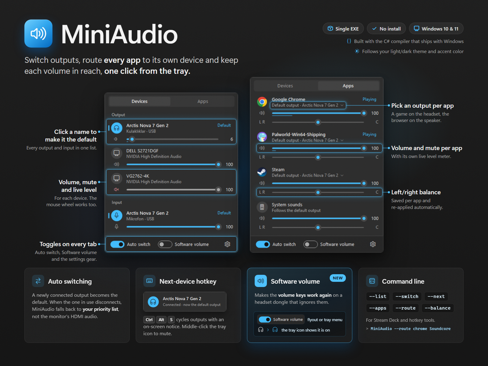

# MiniAudio

Small Windows tray app for switching between audio outputs (USB dongle headset, Bluetooth speaker, …), routing individual apps to different outputs, and managing volume and balance. Single EXE, no installation, built with the C# compiler that ships with Windows.



## Features

- **Devices tab** (left-click the tray icon): every active output and input with its own volume slider, mute button and live level meter. Click a device's name to make it the default; the mouse wheel over a row changes its volume. The toggle at the bottom turns auto switching on or off, the gear opens the settings.
- **Apps tab**: every app that has audio open, with
  - its own **output device**: click the line under the app name, e.g. Discord on the headset and the browser on the Bluetooth speaker. Windows remembers the choice per app.
  - volume and mute,
  - **left/right balance**: drag the second slider, double-click it to center. MiniAudio saves the balance per app and re-applies it when the app opens a new audio session.
- **Auto switching** (applies to devices checked in the settings list)
  - A newly connected output (e.g. a Bluetooth speaker) becomes the default.
  - When the device in use disconnects, MiniAudio switches to the first connected device in your priority list, so Windows does not fall back to something like a monitor's HDMI audio.
  - Monitor/HDMI audio and Bluetooth "Hands-Free" outputs are unchecked by default.
- **Next-device hotkey** (default `Ctrl+Alt+S`, can be changed or turned off): cycles through the checked outputs and shows a short on-screen notice.
- The communications (call) device is switched together with the default device (can be turned off). Optionally the matching microphone is switched too.
- **Software volume** (the toggle at the bottom of the flyout, or right-click the tray icon → *Software volume*): for an output whose own volume control stops working, e.g. a wireless headset dongle that accepts volume changes but ignores them. While it is on, the volume keys and Windows' volume slider also lower the sound on this PC, so they work again. The tray icon is drawn in the Windows accent color while it is on, so you can tell without opening anything. Applies to the current default output and ends when MiniAudio closes or the device disconnects; nothing is saved. See the notes below.
- Middle-click the tray icon to mute/unmute the default output.
- Follows the Windows light/dark theme and accent color.

## Requirements

- Windows 10 or 11 (tested on Windows 11; rounded corners only on Windows 11)
- .NET Framework 4.x, which is part of Windows

## Build & run

No SDK needed; the C# compiler ships with the .NET Framework. In **Command Prompt**, from the repository root:

```bat
C:\Windows\Microsoft.NET\Framework64\v4.0.30319\csc.exe /nologo /codepage:65001 /target:winexe /optimize+ /win32manifest:app.manifest /out:MiniAudio.exe src\*.cs
start "" MiniAudio.exe
```

Only one instance runs at a time; the app lives in the system tray.

### Tests

The channel math behind balance and software volume has tests. Build and run them from the repository root:

```bat
C:\Windows\Microsoft.NET\Framework64\v4.0.30319\csc.exe /nologo /codepage:65001 /target:exe /main:MiniAudio.Tests.TestRunner /out:MiniAudioTests.exe src\*.cs tests\*.cs
MiniAudioTests.exe
```

### Promo image

`promo/miniaudio-4x3.png` (1600×1200) is rendered from `promo/miniaudio-4x3.html` with headless Edge. The pictures in it come from the app itself: `--snapshot` renders the flyout (also with software volume shown as on), the tray icon, the on-screen notice and the settings window to PNG files (dark and light) without changing any setting or level. The snapshots show the devices and apps present at that moment, and the highlight boxes in the page's script are tuned to the committed pictures; adjust them after taking new ones. From the repository root:

```bat
MiniAudio.exe --snapshot promo\snapshots
"C:\Program Files (x86)\Microsoft\Edge\Application\msedge.exe" --headless --disable-gpu --hide-scrollbars --window-size=1600,1200 --screenshot="%CD%\promo\miniaudio-4x3.png" "file:///%CD%/promo/miniaudio-4x3.html"
```

## Command line

Works whether or not the tray app is running (handy for Stream Deck or hotkey tools):

```bat
MiniAudio.exe --list
MiniAudio.exe --switch Soundcore
MiniAudio.exe --next
MiniAudio.exe --apps
MiniAudio.exe --route chrome Soundcore
MiniAudio.exe --balance chrome -30
```

- `--list` prints active outputs and inputs; `*` marks the default device, `c` the communications device.
- `--switch <name|id>` makes the first active device whose name contains the text (or whose id matches) the default.
- `--next` switches to the next checked output in priority order.
- `--apps` lists apps with audio open: volume, balance and output device (`>` = playing now).
- `--route <app> <device|default>` sends an app to an output, e.g. `--route discord Arctis`, or back to the default device.
- `--balance <app> <-100..100>` sets an app's balance (negative = left, 0 = center).

## Settings

Right-click the tray icon → **Settings…** (or the gear in the flyout):

- Device priority order, and which devices take part in auto switching and the hotkey cycle
- Auto switching rules, communications device, microphone, on-screen notice
- Hotkey, microphones in the flyout, start with Windows

Settings are stored in `%APPDATA%\MiniAudio\config.txt`.

## Notes

- Changing the default device uses `IPolicyConfig`, an undocumented Windows COM interface. A future Windows release could change it. Tested on Windows 11 (build 26200).
- Per-app output uses `Windows.Media.Internal.AudioPolicyConfig`, also undocumented. Tested on Windows 11. An app pinned to a device no longer follows default-device switches; set it back to *Default* to make it follow again.
- Routing and balance work per app (process), not per browser tab: routing Chrome moves all of its tabs. Some apps only pick up a new output device when they start a new stream.
- Some 2.4 GHz dongles keep their audio endpoint active even when the headset is switched off, so Windows reports no "connected" event for them. Use the flyout or the hotkey in that case.
- **Software volume, in detail.** Many USB headsets apply volume in the device: Windows sends the new level to the dongle and does not lower the sound itself. Some dongles (seen with an Arctis Nova 7 Gen 2, typically after sleep) acknowledge these changes but stop applying them until they are unplugged; mute keeps working because Windows applies it on the PC. With software volume on, MiniAudio reads the device's level in dB and applies the same level to the channel volumes of every app playing on that device, about every 100 ms. App volumes and left/right balance stay as you set them.
  - Use it only while the device ignores volume changes. If the device works normally, the level is applied twice and the sound is quieter than the slider suggests; turn it off then.
  - It ends when MiniAudio closes, when Windows shuts down or signs out, and when the device disconnects (unplugging usually fixes the dongle). Apps get their full level back, so if the device still ignores volume changes at that moment, the sound gets as loud as the device is set.
  - Windows remembers channel volumes per app. If MiniAudio is closed unexpectedly while software volume is on, apps left lowered get their full level back the next time MiniAudio sees them.
  - Apps that use exclusive mode bypass Windows' mixer and are not affected.
